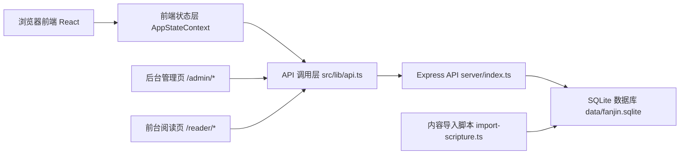

# 系统架构说明

## 1. 项目定位

梵烬网是一个面向佛教古籍数字化、公益共修、原文对白话与祖师注义阅读的前后端一体化网站。

当前版本已经具备：

- 前台阅读与搜索
- 用户登录、收藏、摘录、阅读历史
- 专题共修、活动、讨论
- 后台录入、审核、活动与公告管理
- SQLite 真实数据存储

## 2. 系统组成

### 前端

- 路由入口：`src/App.tsx`
- 公共前台框架：`src/components/SiteLayout.tsx`
- 公共后台框架：`src/components/AdminLayout.tsx`
- 全局样式：`src/index.css`
- 页面目录：`src/pages/`
- API 调用封装：`src/lib/api.ts`
- 前端状态：`src/context/AppStateContext.tsx`

### 后端

- 服务入口：`server/index.ts`
- 数据库初始化与迁移：`server/db.ts`
- 种子数据：`server/data.ts`
- 导入脚本：`server/import-scripture.ts`

### 数据库

- SQLite 文件：`data/fanjin.sqlite`

## 3. 架构关系

## 4. 前端结构

### 前台路由

- `/`：首页
- `/canon`：经藏浏览
- `/reader/:scriptureId`：经文阅读
- `/topics`：专题共修
- `/activities`：活动
- `/search`：搜索
- `/discussion`：讨论
- `/auth`：登录注册
- `/profile`：个人中心
- `/notes`：收藏摘录

### 后台路由

- `/admin`：后台首页
- `/admin/editor`：经文录入与编辑
- `/admin/topics`：专题管理
- `/admin/review`：审核队列
- `/admin/activities`：活动管理
- `/admin/users`：用户与角色管理
- `/admin/settings`：系统配置与公告管理

## 5. 核心业务流

### 经典阅读流

1. 前台进入经藏页
2. 选择经典
3. 进入阅读页
4. 切换段落、白话、祖师注义
5. 保存收藏与摘录
6. 写入阅读历史

### 内容录入与发布流

1. 后台录入新经典或更新经典
2. 经典写入数据库并标记 `pending_review`
3. 同时写入审核队列
4. 审核通过后，经典 `publish_status` 变为 `published`
5. 前台公开接口才会展示该经典

### 讨论流

1. 用户进入讨论区
2. 可按经典或专题筛选
3. 发主题或回复
4. 讨论可带经典、专题关联
5. 可从讨论跳回阅读页

## 6. 当前架构优点

- 前后端职责清晰
- SQLite 适合当前单机部署与中小体量数据
- 后台审核流已能控制前台公开状态
- 导入脚本已接入现有审核发布逻辑

## 7. 当前架构限制

- 暂无独立文件上传服务
- 暂无对象存储
- 暂无全文检索引擎
- 暂无消息通知系统
- 暂无更完整的权限粒度

## 8. 后续可扩展方向

### 数据层

- 从 SQLite 迁移到 PostgreSQL
- 增加全文检索
- 增加音频与附件资源管理

### 应用层

- 增加找回密码、账号安全
- 增加评论审核与风控
- 增加批量导入多部经典

### 部署层

- 前端静态部署
- 后端进程守护
- 数据库备份与日志轮转
