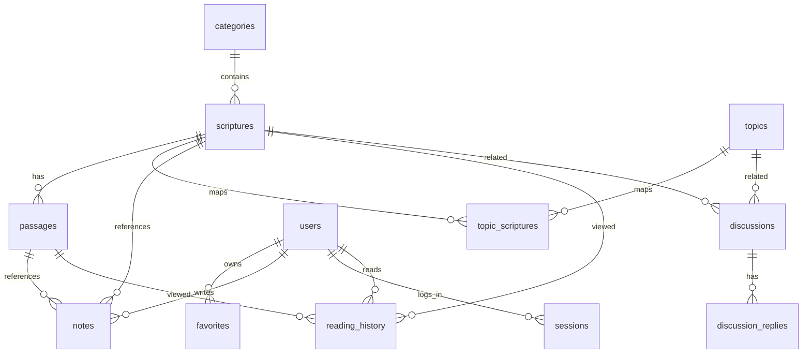

# 数据库设计说明

数据库采用 `SQLite`，文件位于：

- `data/fanjin.sqlite`

初始化与迁移逻辑位于：

- `server/db.ts`

## 1. 表清单

### `categories`

经藏分类表。

字段：

- `id`
- `slug`
- `name`
- `description`
- `sort_order`

### `scriptures`

经典主表。

字段：

- `id`
- `slug`
- `title`
- `category_id`
- `dynasty`
- `translator`
- `role`
- `overlay`
- `summary`
- `publish_status`
- `created_at`

说明：

- `publish_status` 当前会用到：
  - `published`
  - `pending_review`
  - `changes_requested`

### `passages`

经典段落表。

字段：

- `id`
- `scripture_id`
- `slug`
- `title`
- `order_index`
- `original_text`
- `plain_text`
- `commentary_text`
- `audio_url`

说明：

- 一部经典可有多条段落
- `(scripture_id, slug)` 唯一

### `topics`

专题共修主表。

字段：

- `id`
- `slug`
- `title`
- `summary`
- `goal`
- `schedule`
- `duration`
- `participants`

### `topic_scriptures`

专题与经典关联表。

字段：

- `topic_id`
- `scripture_id`

### `announcements`

公告表。

字段：

- `id`
- `title`
- `detail`
- `created_at`

### `activities`

活动表。

字段：

- `id`
- `slug`
- `title`
- `summary`
- `schedule`
- `location`
- `format`
- `status`
- `created_at`

### `users`

用户表。

字段：

- `id`
- `name`
- `password_hash`
- `role`
- `created_at`

### `sessions`

登录会话表。

字段：

- `token`
- `user_id`
- `created_at`

### `favorites`

收藏经典表。

字段：

- `user_id`
- `scripture_id`
- `created_at`

### `notes`

摘录记录表。

字段：

- `id`
- `user_id`
- `scripture_id`
- `passage_id`
- `note`
- `excerpt`
- `created_at`

### `discussions`

讨论主题表。

字段：

- `id`
- `title`
- `scripture_id`
- `topic_id`
- `author_name`
- `body`
- `replies_count`
- `likes_count`
- `created_at`

### `discussion_replies`

讨论回复表。

字段：

- `id`
- `discussion_id`
- `author_name`
- `body`
- `created_at`

### `reading_history`

阅读历史表。

字段：

- `id`
- `user_id`
- `scripture_id`
- `passage_id`
- `viewed_at`

### `review_queue`

审核队列表。

字段：

- `id`
- `title`
- `type`
- `submitter`
- `status`
- `target_kind`
- `target_slug`
- `created_at`

### `site_settings`

站点配置表。

字段：

- `key`
- `value`

## 2. 主要关系

## 3. 种子数据

种子数据位于：

- `server/data.ts`

当前会初始化：

- 默认分类
- 默认经典
- 默认专题
- 默认公告
- 默认活动
- 默认讨论
- 默认审核队列
- 默认站点配置
- 默认用户

## 4. 当前数据库特点

- 适合当前单机部署和中小体量数据
- 初始化简单
- 便于本地开发和内容整理
- 适合作为早期产品 MVP 数据层

## 5. 当前数据库限制

- 不适合高并发多实例写入
- 不适合复杂全文检索
- 音频与大文件目前只保留 URL 字段，不做文件存储

## 6. 后续数据库演进建议

### 保持 SQLite 时

- 增加定时备份
- 增加导入日志表
- 增加评论审核与操作日志表

### 迁移到 PostgreSQL 时

- 保持现有表结构语义不变
- 为 `scriptures.slug`、`passages(scripture_id, order_index)`、`discussions(created_at)` 建立索引
- 可接入全文检索或搜索引擎
