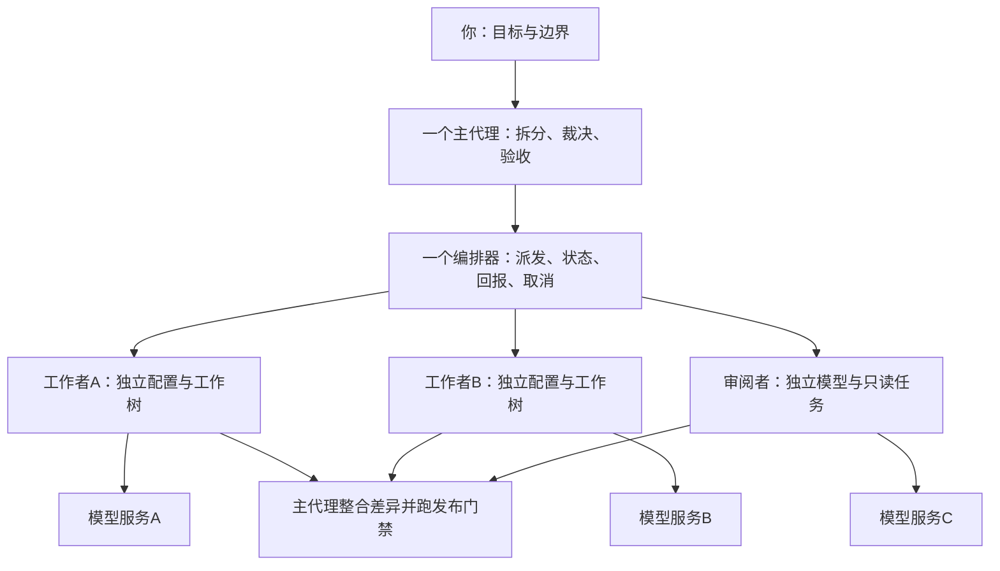

> 历史研究/过程记录（已脱敏）；不是当前任务或执行授权。以仓库 STATUS 和现行工程规范为准。

# 梵烬运营状态与跨终端多模型协作选型

后续开放式调研已完成，扩展至16个工具/框架并核对发行版本。最新综合结论见 [2026-11-21完整报告](../multi-agent-open-landscape/REPORT.md)，本文件保留原帖四种方案的首轮核对范围。

核对日期：2026-11-20。结论区分线上实测、本机只读盘点、官方文档/源码与论坛经验；本轮没有安装候选工具，没有发起外部模型请求，也未修改模型渠道或权限配置。

## 先给结论

梵烬可以按公益非商业、纯静态阅读和本机私人记录的定位正式公开使用。当前发布提交 `cced74c20b085312f7dcbc281b6c6c890f423cb2` 的 [Actions](https://github.com/Lin-Phoeo/fanjin-scripture-library/actions/runs/44751453238) 成功，线上67个版本的目录、心经正文、版权声明、源XML和搜索清单可访问。现有完整发布门禁包含真正的浏览器流程。

不能把“能正式使用”解释为“所有优化结束”。后续优先：大陆/台湾真实网络与Safari/手机试读、大经按章加载的性能评估、持续勘误与来源抽核。最大单书JSON约10.76MB，现行按书加载仍有优化空间；本机200不证明各地区可达，来源验证不等于学术逐字校勘。

针对你的主要诉求——保留正在用的编码助手，同时让不同模型站的模型协作开发——**优先试点 Hey-my-buddy；如果更看重统一界面和每个渠道实例的管理，优先 T3 Code；需要多终端长期保活、跨机器控制则选 Herdr。** DS Bot 更适合希望在群聊中指挥多个Bot的人，但需补足代码工作区和验收隔离。先选一套编排器，避免同时叠加几套任务生命周期。

## 原帖实际说了什么

完整读了 [3212629](https://linux.do/t/topic/3212629) 阅读时的第1–10楼。第10楼是阅读期间新增的回复；这不是对未来新回复的覆盖。进一步读了明确相关的 [Herdr协作实例第9楼](https://linux.do/t/topic/3212464/9) 及周边讨论、[Hey-my-buddy介绍首帖](https://linux.do/t/topic/3192025)。后两篇不宣称全主题评论读遍。

| 楼层 | 实际内容 | 证据边界 |
| --- | --- | --- |
| 1 | 问Gemini指挥GPT、Grok等是否有可用方案 | 是问题，不是已验证方案 |
| 2–3 | 推荐Herdr，提到hc跨终端派活、终端复用和多服务器；链接实际协作流程 | 已追查官方资料，区分产品版本 |
| 4 | 推荐T3 Code，并觉得Herdr界面不好看 | 个人审美，不能据此推断技术优劣 |
| 5 | Hey-my-buddy作者介绍skill驱动的主动委派 | 已追查官方仓库、任务/工作区/原生适配资料 |
| 6 | 推荐DS-Bot，声称子Bot可配不同模型渠道并拉群 | 没有项目链接，名称消歧后的候选身份仍非发帖者确认 |
| 7–9 | 希望桌面Claude、Gemini、Codex相互协作；回复让查Bot框架 | 没提供三个原生桌面App直接互通的可执行方案 |
| 10 | 期待magpie推出框架 | 愿望，不是已提供可用项目 |

Herdr实例的核心价值是角色分工：先建立可检索领域资料，负责人探索方向，实现者做代码/实验，另一模型独立审阅。帖子“效果出色”是个人经验，没有能推导普遍加速倍数的基准。

## 这些工具解决的是不同问题

终端是程序入口，编码助手是能读写/运行工具的程序，模型站提供推理服务，编排器协调多个程序。多开窗口只能增加会话；可靠协作还要有任务身份、文件所有权、独立配置、失败处理和集成验收。

## 四种方案对比

| 方案 | 最适合的目标 | 多模型渠道怎么接 | 工作区与验收 | 对你当前环境的取舍 |
| --- | --- | --- | --- | --- |
| [Hey-my-buddy](https://github.com/Dsssyc/hey-my-buddy) | 继续用现有主代理，自动派发有边界的小任务并验收 | Buddy身份为harness/provider/model/effort；Worker支持Claude、Codex、DSH、ZCode，读取原生配置 | 持久黑板、输入固定、输出封存、明确Host验收/继续/取消；选择managed worktree才有独立副本 | 当前最贴近“减少人工在终端间传话”。Windows已有Codex/DSH使用证据，仍需小范围实测；不能把仅shell里的API变量当作Worker已配置 |
| [T3 Code](https://github.com/pingdotgg/t3code) | 用统一桌面/网页/手机界面管理多个编码代理和环境 | 多provider实例，支持实例环境变量及独立Claude配置目录；Codex有独立与有意共享两种目录模式 | 工作树、diff、线程、源码控制；提供外部MCP/CLI控制，具体委派工具区分调用身份 | 适合你重视界面和多渠道管理的场景。已不只是Codex；本次未证实Gemini CLI的完整具体适配链。默认新线程Full access应在试点明确选择 |
| [Herdr / hc](https://github.com/herdrdev/herdr-core) | 多CLI终端长期运行，代理间派活，跨SSH机器接管 | 模板启动已装CLI；模型和渠道由其原生参数/配置负责 | 支持worktree组织，hc发送/等待/回报；没有自动正确合并的保证 | 适合终端与多机需求。Windows可用，但主Herdr0.9.5、独立hc和新app的状态识别、attach、配置不同，不能混用教程 |
| [DS Bot候选](https://github.com/Fei2411/DS-Bot) | 群聊式指挥多个Bot，延续DSH体验 | 原生Bot选择模型，可接外部Local agents；外部CLI仍用自己的登录/模型 | 群管理员分工、工作目录与记忆；群目录不等于独立Git工作树 | 可作后续界面候选。它是DSH社区项目，非官方同名产品；先确认实际安装和版本，不与Tobs/DSH-Bot混为一谈 |

### Hey-my-buddy必须先验证的点

- 官方文档明确不继承调用者shell里的模型密钥、endpoint覆盖与Host权限。某个终端能调用公益站，不代表对应Worker已经可用；应先让该harness在它自己的原生配置中稳定工作。
- managed worktree、existing和none含义不同；不能把普通目录任务说成隔离。Worktree也共用仓库对象/refs，不能替代系统沙箱。
- Worker结束、结果封存、Host整合测试、accept和资源回收是不同阶段。合成的证据提交不一定适合直接merge。
- Windows文档有实际使用与CI覆盖，也公开了调用者Job约束可能影响服务常驻的边界；不能承诺从任意IDE终端启动都不会随宿主结束。
- 安装文档中的版本示例不一致，正式试用应固定所选发布版及源码；本轮没有安装任何版本。

### Herdr必须分清的点

- 独立hc的状态来自OSC7501上报，不报告就没有状态；主Herdr0.9.5还有屏幕识别。一段时间没有输出不等于任务完成，`idle`不等于批准或验收。
- 主0.9.5的Gemini CLI标记较少测试、主要状态识别。当前独立hc模板可以启动命令，但模板本身不保证特定CLI兼容。
- integration可能修改各编码CLI的hooks/settings；新app有默认遥测和不沙箱化的mods。选型时核具体版本，不盲装全部integration。
- 关viewer可让任务继续，关父终端可能结束子代理；故意脱离的Unix后台任务可能留下。资源收尾仍应验证。

### T3与DS Bot的边界

T3目前确有多provider与外部控制机制，但漂亮界面不自动提供完整的任务验收协议。DS Bot有群聊分工，但“很多Bot聊天”不等于“多人修改同一仓库不会冲突”。不要让几个工具分别创建嵌套工作树、竞争同一Git index或同时发布。

## 你现有环境已经具备什么

只读盘点确认Windows原生Codex、Claude Code和DSH入口。Codex/Claude均支持独立会话参数和工作树；不需要先安装WSL才能并行。当前未发现已安装的WSL分发，tmux型方案不是现成可用路径。

DSH的PATH入口与实际桌面安装来自两个不同版本，这是试点前必须对齐的具体问题。只检查元数据，没有移动目录、切模型或重启你的工作会话。完整本机证据见 local-environment.md（原本地缓存未发布，参见归档索引），该文件是本地研究资料，不用于公开站点。

Codex自己的子代理已经能并行做事，但官方当前说明：子代理文件里的 `model_provider` 不覆盖父会话。若要不同模型站，应使用分别配置的会话/CLI进程或外部编排器；仅在一个子代理文件里换provider不能实现你的目标。[官方子代理说明](https://learn.chatgpt.com/docs/agent-configuration/subagents)

## 公益模型站接入的实际条件

每个Worker都必须明确：使用哪个harness、哪个原生provider、准确model ID、所需接口协议、鉴权来源和并发限制。OpenAI兼容聊天接口不自动等于Codex所需接口；Claude/Gemini的协议、工具调用与长任务行为也需要分别核对。

不要用CC Switch反复改全局“当前provider”冒充独立会话：多个终端可能共同读取它。使用每进程参数、工具支持的独立配置或provider实例。密钥留在原生凭据设施或受控配置，不写入任务书、Git、共享黑板或终端命令历史。

开源编排器不包含模型额度。并行能减少等待，但会增加实际调用；若多个站点共用上游额度，并行可能反而频繁排队。先2个Worker、明确预算/超时/停止条件，再根据完成时间、返工率和消耗决定是否扩展。固定次数/固定时间的试点比无限自动研究更适合当前工程。

## 可直接用于梵烬的试点

先使用一个Host、两个Worker和一个最终Reviewer；初次不启用自动Router，显式选定Buddy，避免把选人调用成本与协作收益混在一起。

第一批为有明确产出的只读微任务，验证跨渠道协作而不动线上产品：

1. **内容Worker**：检查 `scripts/build-catalog.mjs`、`src/lib/local-catalog.ts`，提出最大经典按章加载的数据契约与旧段落URL兼容方案。只读，输出设计及风险，不改经典。
2. **体验Worker**：检查Reader/Book页面与现有Playwright用例，给出按章加载的加载态、失败恢复和320px验收条件。只读，不重做已认可设计。
3. **Host**：比较两份结果，解决数据契约交叉点，再形成可实施任务，明确每个文件的唯一负责人。
4. **Reviewer**：用另一已配置模型核对两份方案及现有备份/书签不变量，指出遗漏，最终由Host裁决。

试点通过条件：Worker实际使用指定provider/model，任务ID与输出可追踪，中途修改任务与取消可控，不互改全局配置，不碰用户阅读标签，结束能确认子进程/临时服务收尾。记录总耗时、模型用量与返工；只有过关后才扩展为并行写代码。

写代码阶段每个Worker独立worktree，Host统一处理package锁文件、公共契约、集成、`npm run check:release`和发布。先确定共用接口再拆并行实现，避免同一接口两边各猜一套。

本节是已准备好的试点范围和验收标准，不是已运行的跨模型试点。候选工具安装、具体模型渠道选择及实际请求仍未执行。

## 浏览器连接问题的实际结果

既有DSH CDP入口9223当时不可用；终端启动调试Chrome的操作被执行策略拒绝，未提供细分原因。随后内置浏览器成功读完原帖。外部Chrome最初只有原生窗口入口，遇最小化和网址识别失败。

用户确认Chrome在桌面应用的Computer Use中显示Manage后，本轮工具清单出现了Chrome的extension连接。已实际通过该连接读取准确帖子URL与正文，创建同站临时验证标签、关闭后再次列出确认消失，原帖子保留。没有关闭安全校验，也没有改全局审批或导出Cookie。

后续优先使用已连接的 `@Chrome`/具体标签或内置 `@Browser`；站点允许设置解决重复站点提示，不能绕过不可验证网址。文件/终端权限与浏览器连接是不同层，普通读帖无需额外开启完整CDP。

## 来源与研究边界

- 主帖及相关实例：前文三个linux.do链接，浏览器实际渲染文本；DSH失败manifest不冒充成功原文缓存。
- [Herdr官方核对](HERDR-OFFICIAL-REPORT.md)：13份官方资料、不同产品版本、关键限制与来源索引。
- [T3/Buddy官方及源码核对](t3-buddy-review.md)：provider、权限、工作区、取消、Windows、未完成核对项。
- 本机盘点与DS Bot消歧（原本地缓存未发布，参见归档索引）：版本/help及配置键名、公开文档，不包含密钥。
- [Codex配置](https://learn.chatgpt.com/docs/config-file/config-advanced)、[Claude设置](https://code.claude.com/docs/en/settings)、[浏览器连接官方步骤](https://learn.chatgpt.com/docs/chrome-extension)。

Perplexity与Firecrawl搜索用于发现，最终结论以帖子原文、官方文档和已核源码为准。SearXNG本地未运行；部分官方站点受到网络解析限制，改读官方GitHub；API限流导致个别实现/版本核对不完整，详见分报告。没有把搜索摘要、截图中的型号或论坛推荐当成已实测性能结论。
