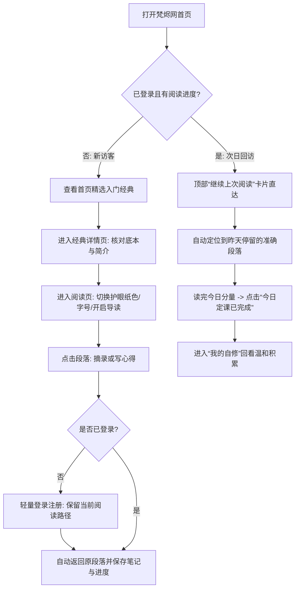

# 梵烬网（个人自修驿站）深度产品与技术实施方案

> **文档属性**：产品规划 / 版权合规 / 视觉排版 / 全栈架构实施总纲  
> **技术栈基线**：`Vite + React + TypeScript + react-router-dom + Express + SQLite (better-sqlite3)`  
> **部署目标**：日本东京 Azure 单机节点  
> **事实声明**：未获取仓库源码与服务器实况，所有涉及代码现状的判断均标注 **`[需开发者核对]`**；外部许可与价格信息查阅基准日期为 **2026 年 11 月**。

---

## 目录

1. [核心结论与最终推荐](#1-核心结论与最终推荐)
2. [同类产品调研与借鉴边界](#2-同类产品调研与借鉴边界)
3. [产品定位、用户故事与功能优先级](#3-产品定位用户故事与功能优先级)
4. [经典来源、使用许可与首版书目](#4-经典来源使用许可与首版书目)
5. [信息架构、页面设计与视觉规范](#5-信息架构页面设计与视觉规范)
6. [数据模型、接口契约与工程方案](#6-数据模型接口契约与工程方案)
7. [内容运维与东京单机部署方案](#7-内容运维与东京单机部署方案)
8. [分阶段开发路线与上线验收清单](#8-分阶段开发路线与上线验收清单)
9. [状态清单、待决事项与来源索引](#9-状态清单待决事项与来源索引)

---

## 1. 核心结论与最终推荐

### 1.1 产品定位与不可逾越的边界 `[产品建议]`
* **核心定位**：公益性质的“无社交压力、有学术根基的东方经典个人自修阅读器”。
* **核心闭环**：`发现经典` → `开始阅读（记住精确位置）` → `摘录与私人心得` → `建立个人自修计划与每日定课` → `长期回看与一键导出`。
* **明确边界（坚决不做）**：
  * 剥离或关闭仓库中可能残留的活动报名、多人共修、论坛评论、排行榜、社交关注、商城入口 `[需开发者核对]`。
  * 不展示任何虚构的在线人数、修学人数、点赞数与运营热度。
  * 不设连续打卡惩罚（断签不焦虑），不将不同学派混为一谈，不把网站包装成宗教权威。
  * 严禁使用 AI 自动生成解释并署名为祖师注义，或将生成文本混作古籍原文。

### 1.2 名称适配性评估 `[产品建议]`
* **评估**：“梵烬网”有禅意和辨识度，但单看字面容易偏佛家或略带“寂灭”感。
* **推荐**：**保留主名与域名“梵烬”以维持项目延续性，无需为改名阻塞上线**；在导航与首页统一搭配副标题——**`梵烬 · 东方经典个人自修驿站`**，清晰传达释、道、儒兼收的定位。

### 1.3 视觉、内容与架构三大决策 `[产品建议]`
1. **内容策略（先严选、忌全盘）**：首版聚焦 **15 部**适合日常反复诵读的佛道核心经典（兼收少量儒家基础篇目）。原文严格选用 **CBETA** 与 **维基文库（CC BY-SA 4.0）** 合规底本；注释仅放公版古注与团队人工编校的简明导读，严禁抓取现代学者受版权保护的白话全译本。
2. **视觉策略（宣纸斋墨）**：采用低刺激暖调现代横排极简风，放弃仿古竖排与冗余禅意插画。专注版心宽度（`660px–700px`）、高可读字号行距（`18px / 1.9`）与系统原生衬线字体栈，确保首屏秒开。
3. **技术策略（稳健延续）**：**继续沿用现有技术栈**，不引入微服务、PostgreSQL 或 Elasticsearch。开启 SQLite **WAL 模式**，用**稳定的业务逻辑键（`slug + chapter_key + para_key`）+ 原文快照**彻底解决经典勘误导致用户笔记错位的问题。

---

## 2. 同类产品调研与借鉴边界

基于 8 个海内外代表性产品的实际机制对比 `[已核实事实]` 与吸收策略 `[产品建议]`：

| 产品 | 类别 | 核心长板（可借鉴） | 版权/可信度机制 | 不适合本项目的部分（规避） |
| :--- | :--- | :--- | :--- | :--- |
| **CBETA Online** | 佛典数字库 | 底本与卷号标注极其严谨；复制引文自带规范出处。 | 公开标明底本、校勘来源与非商用公益授权条款。 | 界面偏学术工具化，满屏校勘符号对静心长读有门槛。 |
| **中国哲学书电子化计划 (ctext)** | 先秦道儒库 | 原典自然段切分清晰，赋予稳定段号；桌面端对照阅读直观。 | 明确标注底本，**严禁未经许可的自动爬虫和镜像采集**。 | 视觉与移动端适配偏旧；不能作为批量采集来源。 |
| **SuttaCentral** | 巴利/早期佛典 | 极现代克制的排版、舒适的行距与深浅主题切换；去宗教权威感。 | 底本、译者与开放协议（CC0 等）极其透明。 | 多语种学术对照过重，超出中文日常自修需求。 |
| **微信读书 (Web/App)** | 现代中文阅读器 | 中文排版、护眼纸张底色、平滑续读与个人笔记流导出体验极佳。 | 商业正版授权。 | 强社交化（热门划线、阅读时长排行），极易制造焦虑。 |
| **Readwise Reader** | 精读与笔记归档 | 专注阅读流、轻量级高亮笔记、强“数据主权”理念（随时导出 MD）。 | 用户个人内容为主。 | 工作流复杂、学习成本过高且为重度订阅制。 |
| **Matter / Read.cv** | 极简数字阅读 | 严格控制版心单行字数，留白克制，无冗余卡片和装饰背景。 | 精选内容为主。 | 缺乏古籍“藏/部/经/卷/品”的多级结构导航。 |
| **Habitica / 番茄ToDo** | 习惯与专注管理 | 轻量级“今日已完成”的温和确认反馈。 | 不适用。 | 游戏化积分、排行榜与严厉的断签惩罚机制。 |
| **维基文库 (Wikisource)** | 开放协作古籍库 | 合规成本极低的公版古籍文本源。 | CC BY-SA 4.0 / 公有领域（须署名并保留协议）。 | 原始 Wiki 排版简陋、校对质量参差，必须人工清洗再入库。 |

---

## 3. 产品定位、用户故事与功能优先级

### 3.1 目标用户与分阶段价值
* **三类核心服务对象**：
  1. **都市寻静者（初级入门）**：25–40 岁，希望在睡前或午休花 10–15 分钟安静读一段《心经》《道德经》，需要清爽界面和可靠的简明导读。
  2. **长期定课自修者（中度深入）**：有早晚定课习惯（如每日一遍《金刚经》），需要极速续读、温和的计划打卡和长期感悟沉淀。
  3. **跨派别古典思想爱好者**：佛道儒兼读，习惯对照古注、随手摘录金句，并重视个人笔记的本地导出备份。
* **三阶段用户价值**：
  * **首次访问**：免登录直接试读，3 秒进入书斋阅读体验，清晰看到底本来源与学派分类。
  * **每天使用**：首页一键回到上次停下的准确段落，顺手标记今日定课或记两句心得。
  * **长期回访**：沉淀出可按经典/时间回看的私人修学档案，且支持随时一键导出带走。

### 3.2 十个具体用户故事（User Stories）

| 编号 | 场景 | 用户操作 | 可观察的完成结果 |
| :--- | :--- | :--- | :--- |
| **US-01** | 匿名初探 | 未登录打开首页，点击《道德经》，切换“护眼古纸”和大字号，展开现代导读。 | 无强制登录弹窗；排版样式立即生效并写入 `localStorage`。 |
| **US-02** | 无痛绑定 | 读到感触处点击“写心得”，在轻提示引导下完成注册登录。 | 登录后自动跳回原章节段落，本地阅读偏好与当前位置同步入库。 |
| **US-03** | 次日续读 | 第二天打开首页，点击顶部“继续上次阅读：《金刚经·第八品》”。 | 页面直接打开对应章节并平滑滚动定位到上次停留的具体段落。 |
| **US-04** | 建立定课 | 在“我的自修”选择经典，设定自由节奏（如“每日1章”），读完点击“今日完成”。 | 写入当日温和完成记录，累计次数 +1；中断几天后回来无任何惩罚提示。 |
| **US-05** | 摘录心得 | 点击《庄子·逍遥游》某段旁的“摘录/笔记”，写下 100 字感悟并保存。 | 该段出现极淡的“已笔记”印记；`/notes` 中可同时看到原文引用与心得。 |
| **US-06** | 精准搜索 | 顶部搜索框输入“无住”或“無住”。 | 列出跨经典命中结果与高亮片段，点击后直达目标段落并短暂高亮 2 秒。 |
| **US-07** | 核验版本 | 在阅读页点击书名或“版本出处”查看《六祖坛经》信息。 | 清晰展示底本（宗宝本）、数字来源（CBETA）、许可协议与译注说明。 |
| **US-08** | 按派筛选 | 进入经藏目录，筛选“道家 + 入门短篇”。 | 列表实时收窄，每张卡片清晰标注字数估计及“全文/节选”角标。 |
| **US-09** | 导出档案 | 在“我的摘录与心得”点击“导出 Markdown”。 | 浏览器直接下载结构规范的 `.md` 文件，含原文、出处、时间与心得。 |
| **US-10** | 勘误修补 | 读者提交错字反馈，管理员在后台核对底本后修改该段文字。 | 线上更正生效，原有读者基于该段写的笔记依然稳固存在且保留原摘录快照。 |

### 3.3 功能优先级矩阵

| 功能模块 | 优先级 | 范围界定与实施要点 |
| :--- | :--- | :--- |
| **经藏分类与筛选** | **P0 首版** | 学派（佛/道/儒及诸子）+ 基础标签（入门短篇/日常定课），不做多层复杂联动。 |
| **经典详情与版本信息** | **P0 首版** | 完整展示底本、来源链接、版权协议、全文/节选标注与章节树。 |
| **核心阅读器** | **P0 首版** | 目录侧栏、4 档字号、行距、3 套主题、繁简切换、自动防抖保存阅读位置。 |
| **原文与导读/注疏对照** | **P0 首版** | 纯原文 / 对照模式切换；物理与视觉严格区分“古代注疏”和“现代编校导读”。 |
| **全文搜索与段落跳转** | **P0 首版** | 简繁联合查询、命中上下文高亮、锚点直达段落；严格过滤草稿与下架内容。 |
| **收藏、摘录、心得与导出** | **P0 首版** | 段级笔记、自动存原文快照、按书筛选、一键导出 `.md` / `.json`。 |
| **私人自修计划与定课** | **P0 首版** | 创建温和计划、每日防重打卡、支持最近 3 天温和补记、累计进度回顾。 |
| **账号安全与数据隔离** | **P0 首版** | 加盐哈希密码、`HttpOnly` Cookie、全接口强制 `user_id` 越权隔离、全量数据导出。 |
| **内容管理后台** | **P0 首版** | 管理员标准 JSON 批量导入/更新、预览校对、发布/下架切换、勘误工单处理。 |
| **移动端、空状态与无障碍** | **P0 首版** | 移动端单栏触控优化、明确空状态与失败重试、键盘焦点与减少动画偏好支持。 |
| **经典异本并列对读** | **P1 后续** | 如《坛经》敦煌本与宗宝本逐段对照。 |
| **温和月度回顾 / 账号自助注销** | **P1 后续** | 按月回顾积累（不做炫耀海报）；提供自助校验销毁全部个人数据。 |
| **PWA 离线阅读** | **P1 后续** | 缓存静态资源与近期常读的 1–2 部经文，需设计好勘误缓存失效策略。 |
| **音频诵读 / 定时推送提醒 / AI 辅助解经** | **暂不做** | 见下节专项评估。 |
| **社区、共修、排行、商城、虚构热度** | **绝对不做** | 违背静心自修定位，坚决清理。 |

### 3.4 延伸能力专项评估

| 评估项 | 用户价值 | 外部依赖与风险 | 运行成本 | 建议阶段与理由 |
| :--- | :--- | :--- | :--- | :--- |
| **音频诵读** | 中高（听经） | 高质量无版权纠纷诵读极稀缺；TTS 念佛道专名（如般若）极易读错毁口碑。 | 音频存储与 CDN 带宽成本高。 | **暂不做**。避免低质 TTS 破坏格调。 |
| **PWA / 离线阅读** | 中高（无网环境） | 需处理 Service Worker 缓存更新与离线笔记冲突合并。 | 开发维护中等。 | **P1 后续**。首版优先保障网页秒开。 |
| **跨设备同步** | 中 | 基于现有服务端 SQLite + 登录态天然支持（刷新拉取最新进度）。 | 零额外费用。 | **P0 基础支持**（无需复杂 WebSocket 推送）。 |
| **邮件/推送提醒** | 低中 | 依赖 SMTP 发信服务或第三方推送，易成为通知焦虑源。 | 需维护发信信誉与潜在费用。 | **暂不做**。把提醒权交还用户手机闹钟。 |
| **AI 辅助阅读** | 表面高，风险极高 | 古籍专有名词幻觉率高，一旦胡编法义直接摧毁平台公信力。 | 持续按 Token 付费，公益站难以承压。 | **暂不做**。坚守“只呈现可靠原典与人工校核注释”。 |

### 3.5 P0 核心功能验收规格

1. **经藏分类与筛选**
   * 输入/操作：点击学派或特征标签 → 查询 `status = 'published'` 经典列表。
   * 异常与验收：无结果时显示重置引导；300ms 内响应；草稿和已下架书籍绝不出现。
2. **经典详情与版本信息**
   * 输入/操作：访问 `/book/:slug` → 加载元数据、许可声明与章节目录。
   * 异常与验收：无效或下架 `slug` 返回规范 404；必须明确区分“古代作者/译者”和“当前数字化来源与协议”。
3. **核心阅读器与续读**
   * 输入/操作：访问 `/read/:slug/:chapterKey` → 读取样式偏好；登录后以 2 秒防抖上报 `last_chapter_key` 与 `last_para_key`。
   * 异常与验收：进度上报失败静默降级至 `localStorage` 不弹窗打扰；切主题无闪烁；次日点击“继续阅读”可精准定位至上次段落。
4. **全文搜索与段内跳转**
   * 输入/操作：输入 ≥1 个汉字 → 简繁等价匹配已发布段落 → 点击跳转 `/read/:slug/:chapterKey#p-:paraKey`。
   * 异常与验收：严格转义 SQL/通配符防注入；输入“无”和“無”均可命中；跳转后目标段落位于视口内并柔和闪烁高亮 2 秒。
5. **私人摘录与心得**
   * 输入/操作：段落点击写笔记 → 保存外键与 `quoted_text_snapshot` → `/notes` 浏览或导出 `.md`。
   * 异常与验收：防连点重复提交；A 账号请求 B 账号笔记必返 `403/404`；原文修订后笔记内依然保留当年摘录快照。
6. **私人自修计划与每日功课**
   * 输入/操作：创建计划 → 点击“今日定课完成”或 3 天内补记（前端传本地 `YYYY-MM-DD`）。
   * 异常与验收：数据库 `UNIQUE(plan_id, log_date)` 保障幂等，1 秒连点 5 次仅存 1 条记录；无断签惩罚文案。

---

## 4. 经典来源、使用许可与首版书目

### 4.1 权利分层与来源核查（查阅日期：2026年11月）`[已核实事实]`

必须严格区分三层权利：
1. **古代原文**：先秦至清末原典本身处于**公有领域**。
2. **现代标点、校勘与数据库成果**：受现代《著作权法》或数据库条款保护。**网页公开可见 ≠ 允许爬虫批量采集再分发**。
3. **现代学者白话译注**：受严格现代著作权保护，未经书面授权**严禁收录**。

| 数据源 | 覆盖范围 | 条款与关键限制 | 本项目使用策略 |
| :--- | :--- | :--- | :--- |
| **CBETA Online** (`cbeta.org`) | 汉传大藏经核心佛典 | 非营利公益流通，禁止商用；必须保留底本、卷号、出处及版权声明，有改动须明示。 | **P0 佛典主力来源**。清洗为阅读格式时强制保留来源标注与非商声明。 |
| **维基文库 中文站** (`zh.wikisource.org`) | 佛道儒主流经典 | 默认 **CC BY-SA 4.0** 或公有领域；允许再分发与重新排版，必须署名并沿用相同许可。 | **P0 道儒主力来源**。因网友录入质量不一，入库前必须人工对照底本核验标点。 |
| **中国哲学书电子化计划** (`ctext.org`) | 先秦两汉典籍极全 | **明文禁止未授权批量自动采集与镜像复制**；API 仅限注册学术研究且限流。 | **仅作人工核字查考工具，严禁爬虫抓取其文本或译注**。 |
| **无明确授权聚合站** | 各类古籍搬运站 | 版权链路不明、错字率高。 | **禁用**。 |

### 4.2 首版 15 部经典推荐清单 `[产品建议]`

原则：篇幅在百字至两万字区间，适合日常反复静读；大部头严守**“明确标注节选”**。

| # | 书名 | 学派 | 作者/译者与建议底本 | 适合人群 | 篇幅标注 | 推荐来源 | 许可状态 | 导入难度 |
| :-: | :--- | :---: | :--- | :--- | :--- | :--- | :--- | :---: |
| 1 | 《般若波罗蜜多心经》 | 佛家 | 唐·玄奘译（流通本） | 全民入门、早晚定课 | **全文** (~260字) | CBETA / 维基文库 | 已确认(非商/CC) | 极低 |
| 2 | 《金刚般若波罗蜜经》 | 佛家 | 姚秦·鸠摩罗什译（32分本） | 核心日常诵读经典 | **全文** (~5100字) | CBETA (`T08n0235`) | 已确认(须署名) | 低 |
| 3 | 《六祖大师法宝坛经》 | 佛家 | 元·宗宝编通行本 | 禅修入门、直指人心 | **全文** (~2.1万字) | CBETA (`T48n2008`) | 已确认(须署名) | 中 |
| 4 | 《佛说阿弥陀经》 | 佛家 | 姚秦·鸠摩罗什译 | 净土基础定课 | **全文** (~1800字) | CBETA (`T12n0366`) | 已确认(须署名) | 低 |
| 5 | 《法华经·观世音菩萨普门品》 | 佛家 | 姚秦·鸠摩罗什译 | 慈悲修养、大众定课 | **单品节选** (~2000字) | CBETA (`T09n0262`) | 已确认(须署名) | 低 |
| 6 | 《佛遗教经》 | 佛家 | 姚秦·鸠摩罗什译 | 临终平实教诲、日常持戒 | **全文** (~2400字) | CBETA (`T12n0389`) | 已确认(须署名) | 低 |
| 7 | 《维摩诘所说经》（核心三品） | 佛家 | 姚秦·鸠摩罗什译（佛国/方便/入不二法门） | 在家居士、生活即修行 | **明确节选** (~6000字) | CBETA (`T14n0475`) | 已确认(须署名) | 中 |
| 8 | 《道德经》 | 道家 | 春秋·老子（王弼本纯原文） | 东方智慧基石、每日两章 | **全文** (81章/~5200字) | 维基文库(人工校) | 已确认(CC BY-SA 4.0) | 低 |
| 9 | 《庄子·内篇》 | 道家 | 战国·庄周（郭象本纯原文） | 安顿精神、消解焦虑 | **内篇全文** (7篇/~1.4万字) | 维基文库(人工校) | 已确认(CC BY-SA 4.0) | 中 |
| 10 | 《太上老君说常清静经》 | 道家 | 佚名（《正统道藏》通行本） | 道教日诵、修习清静心 | **全文** (~400字) | 维基文库 | 已确认(CC BY-SA 4.0) | 极低 |
| 11 | 《庄子·外杂篇》精选 | 道家 | 战国·庄周及后学（《秋水》《达生》） | 探讨边界与专注力 | **明确节选** (~5000字) | 维基文库 | 已确认(CC BY-SA 4.0) | 低 |
| 12 | 《心印妙经》 | 道家 | 《正统道藏》本 | 精气神修养短篇 | **全文** (~200字) | 维基文库 | 已确认(CC BY-SA 4.0) | 极低 |
| 13 | 《大学》 | 儒家 | 礼记旧篇·朱熹章句本 | 为学立身总纲 | **全文** (~1700字) | 维基文库 | 已确认(CC BY-SA 4.0) | 极低 |
| 14 | 《中庸》 | 儒家 | 礼记旧篇·朱熹章句本 | 慎独功夫与日常处世 | **全文** (~3500字) | 维基文库 | 已确认(CC BY-SA 4.0) | 低 |
| 15 | 《论语》（精选四篇） | 儒家 | 先秦记录（学而/为政/里仁/述而） | 日常践履、慢读沉思 | **明确节选** (~4000字) | 维基文库 | 已确认(CC BY-SA 4.0) | 中 |

### 4.3 文本整理与防伪规范
1. **三层文本物理隔离**：严格切分为 `原文 (original)`、`古代注疏 (classical_commentary，必须带作者/书名/卷次)`、`现代编校导读 (modern_guide，明确标注本站编者注)`。
2. **宁缺毋滥原则**：某段暂无可靠导读或古注时直接留空不显示，绝不硬凑白话，严禁 AI 生成内容冒充祖师注疏或古籍原文。
3. **繁简与异体字处理**：数据库同时存储**规范繁体正字 (`content_tc`)** 与**经古籍词表校对预处理后的简体 (`content_sc`)**，杜绝直接一字一对一转换导致的“皇後/發財”级错漏；极生僻异体字在不影响义理前提下规范为通用正字或加编者注音释义。
4. **版本差异**：首版选定单一公认稳定通行底本，在版本卡中说明异本存在情况，不在正文塞满学术方括号干扰阅读。

---

## 5. 信息架构、页面设计与视觉规范

### 5.1 导航与完整页面清单

* **桌面端顶栏**：`梵烬 · 东方经典自修驿站` | `首页` | `经藏目录` | `我的自修` | `摘录心得` | `[搜索框]` | `[登录/账号]`
* **移动端底栏**：`首页` | `经藏` | `自修` | `我的`（搜索置于首页与经藏顶部）

| 页面 | 路由 | 目标与核心区域 | 未登录 / 空状态 / 异常处理 | 桌面 vs 移动端差异 |
| :--- | :--- | :--- | :--- | :--- |
| **首页** | `/` | 老用户 1 秒续读；新访客快速入门试读。顶部动态续读卡/极简宣言 + 今日定课入口 + 精选入门书架 + 底部许可声明。 | 未登录隐藏续读卡，展示精选入门引导；接口异常提供友好重试而不白屏。 | 桌面多列精选网格；手机单列纵向卡片，续读按钮全宽易点。 |
| **经藏目录** | `/library` | 按学派与标签发现经典。胶囊筛选栏 + 典籍书架卡（含全文/节选角标与字数）。 | 无筛选命中时显示“重置筛选”按钮。 | 桌面 3 列卡片；手机单列列表，筛选条可横向轻扫。 |
| **经典介绍页** | `/book/:slug` | 建立学术公信力并提供章节直达。书名元数据 + 底本/版权声明卡 + 完整章节目录 + “开始/继续阅读”主按钮。 | 不存在或下架返回 404 并引导回 `/library`。 | 桌面双栏头图元数据；手机纵向堆叠，主按钮吸底或置顶。 |
| **阅读页** | `/read/:slug/:chapterKey` | 沉浸读经、对照注疏、记笔记。居中主正文栏 + 可收起目录 + 段级轻量操作条 + 悬浮外观设置（主题/字号/行距/繁简/注疏开关）。 | 加载中用极淡骨架屏；上报进度失败静默落本地；写笔记未登录时轻引导登录并保留当前页回跳。 | 桌面居中 `680px` + 侧边可展开目录/笔记抽屉；手机全屏纯读，轻触呼出底部极简控制条。 |
| **搜索页** | `/search` | 跨经精准检索与段内高亮跳转。大搜索框 + 简繁说明 + 上下文高亮结果列表。 | 空态展示推荐短词（如“无住”“不争”）；无结果提示缩短关键词。 | 布局一致，手机端放大点击热区。 |
| **我的自修** | `/study` | 管理个人计划、每日定课与最近阅读历史。今日待完成定课 + 最近阅读 5 本 + 温和累计指标。 | 未登录展示产品说明与登录引导；无计划引导“选一本书每天静读 10 分钟”。 | 桌面左右分栏（定课 vs 历史）；手机纵向堆叠，定课优先置顶。 |
| **摘录与心得** | `/notes` | 长期沉淀回看与数据带走。经典筛选 + 一键导出 MD + 卡片流（浅灰原文引用块 + 黑色正文心得 + 跳回原段链接）。 | 无笔记提示“阅读时点击任意段落即可记录感悟”。 | 桌面双栏或宽单栏时间线；手机纯单栏，操作收进“更多”。 |
| **账号与隐私** | `/settings` | 修改密码、全量个人数据导出（MD/JSON）、隐私说明与退出登录。 | 未登录强制重定向至登录页。 | 居中窄表单，两套端体验一致。 |
| **内容管理后台** | `/admin` | 仅管理员可见。典籍状态表（草稿/已发布/已下架）+ JSON 导入预览器 + 用户勘误工单修补。 | 非管理员直接返回 403/404。 | 以桌面端高效运维为优先。 |

### 5.2 核心用户流程（首次体验 & 次日续读）



### 5.3 视觉与中文排版规范（推荐方向：“宣纸斋墨”）

* **放弃方案**：① 仿古线装竖排风（屏幕长读极累，不利搜索高亮）；② 纯白技术文档风（过冷缺文化气韵）。
* **最终推荐**：**“宣纸斋墨”（Paper & Ink）**——现代横排极简，温润宣纸底色配柔墨正文，仅用克制的印泥朱红标记核心操作与笔记印记，禁用禅意水墨背景图与装饰动效。

#### 主题色板 Token
| 主题 | 画布背景 | 卡片/侧栏面 | 主正文色 | 次要/注疏色 | 强调色（朱红/青黛） | 分割线 |
| :--- | :--- | :--- | :--- | :--- | :--- | :--- |
| **素宣（默认亮色）** | `#FAF8F5` | `#F3EFEA` | `#24211E` | `#68625D` | `#9B3B31` / `#3E5C58` | `#E5E0D8` |
| **古纸（低刺激护眼）** | `#F2EBD9` | `#E9E0CA` | `#2A241E` | `#6E6354` | `#8F342A` | `#DCD1BA` |
| **松烟（暗黑静夜）** | `#161616` | `#1F1F1E` | `#D5CFC7` | `#8A847C` | `#C1594D` | `#2B2A28` |

#### 字体、排版几何与无障碍参数
* **字体加载策略（零体积负担）**：首版禁止加载十几 MB 的全量 Webfont。
  * **UI 界面**：`-apple-system, BlinkMacSystemFont, "PingFang SC", "Hiragino Sans GB", "Microsoft YaHei", sans-serif`
  * **经典正文**：`"Songti SC", "Noto Serif CJK SC", "Source Han Serif SC", "SimSun", Georgia, serif`
  * *(P1 可选)*：引入开源免费（SIL OFL 1.1）的**霞鹜文楷（LXGW WenKai）**按字库分片子集按需加载。
* **核心排版参数**：
  * 桌面阅读栏最大宽度：`660px – 700px`（控制每行 **32–38 个汉字**）。
  * 正文字号档位：`16px (小)` / **`18px (桌面默认)` / `17px (手机默认)`** / `20px (大)` / `23px (特大)`。
  * 正文行高：`1.85 – 1.95`；注疏/导读字号较正文小 `2px`，行高 `1.7`；段间距 `1.25em – 1.5em`。
  * 移动端左右留白 `20px–24px`，所有交互热区 `≥ 44px × 44px`。
* **无障碍底线**：正文对比度 `≥ 7:1`（暗黑亦达 AA+ 级）；全站支持 `Tab` 键盘焦点与清晰 `:focus-visible` 轮廓；尊重 `prefers-reduced-motion: reduce`，所有过渡动画 `≤ 180ms`。

---

## 6. 数据模型、接口契约与工程方案

### 6.1 SQLite 核心 Schema（增量演进参考）

> **注意**：实施前必须先核对仓库现有表结构 `[需开发者核对]`，通过安全增量迁移保护已有数据。运行时必须开启 `PRAGMA foreign_keys = ON; PRAGMA journal_mode = WAL; PRAGMA busy_timeout = 5000;`。

```sql
-- 1. 经典主表
CREATE TABLE IF NOT EXISTS books (
    id INTEGER PRIMARY KEY AUTOINCREMENT,
    slug TEXT NOT NULL UNIQUE,           -- 稳定业务键，如 'heart-sutra'
    title TEXT NOT NULL,
    subtitle TEXT,
    tradition TEXT NOT NULL,             -- 'buddhism' | 'taoism' | 'confucianism' | 'other'
    is_excerpt INTEGER DEFAULT 0,        -- 0: 全文, 1: 节选
    author_era TEXT,
    word_count INTEGER DEFAULT 0,
    description TEXT,
    source_name TEXT NOT NULL,           -- 如 'CBETA Online (T08n0251)'
    source_url TEXT,
    license_info TEXT NOT NULL,          -- 如 'CC BY-SA 4.0'
    status TEXT DEFAULT 'draft',         -- 'draft' | 'published' | 'archived'
    sort_order INTEGER DEFAULT 0,
    created_at DATETIME DEFAULT CURRENT_TIMESTAMP,
    updated_at DATETIME DEFAULT CURRENT_TIMESTAMP
);

-- 2. 卷章表（逻辑键防重导断链）
CREATE TABLE IF NOT EXISTS chapters (
    id INTEGER PRIMARY KEY AUTOINCREMENT,
    book_id INTEGER NOT NULL REFERENCES books(id) ON DELETE CASCADE,
    chapter_key TEXT NOT NULL,           -- 稳定不变，如 'ch-01'
    volume_title TEXT,
    title TEXT NOT NULL,
    sort_index INTEGER NOT NULL,
    UNIQUE(book_id, chapter_key)
);

-- 3. 段落正文与三层注释表
CREATE TABLE IF NOT EXISTS paragraphs (
    id INTEGER PRIMARY KEY AUTOINCREMENT,
    chapter_id INTEGER NOT NULL REFERENCES chapters(id) ON DELETE CASCADE,
    para_key TEXT NOT NULL,              -- 稳定不变，如 'p-01'
    sort_index INTEGER NOT NULL,
    content_tc TEXT NOT NULL,            -- 规范繁体原文
    content_sc TEXT NOT NULL,            -- 校对预处理简体原文
    classical_commentary TEXT,           -- 古代注疏
    commentary_source TEXT,              -- 古注出处（作者+书名+卷次）
    modern_guide TEXT,                   -- 现代编者简明导读
    updated_at DATETIME DEFAULT CURRENT_TIMESTAMP,
    UNIQUE(chapter_id, para_key)
);

-- 4. 用户表
CREATE TABLE IF NOT EXISTS users (
    id INTEGER PRIMARY KEY AUTOINCREMENT,
    email TEXT NOT NULL UNIQUE,
    username TEXT NOT NULL,
    password_hash TEXT NOT NULL,         -- bcrypt / argon2 / scrypt
    role TEXT DEFAULT 'user',            -- 'user' | 'admin'
    created_at DATETIME DEFAULT CURRENT_TIMESTAMP
);

-- 5. 阅读进度表
CREATE TABLE IF NOT EXISTS reading_progress (
    user_id INTEGER NOT NULL REFERENCES users(id) ON DELETE CASCADE,
    book_id INTEGER NOT NULL REFERENCES books(id) ON DELETE CASCADE,
    last_chapter_key TEXT NOT NULL,
    last_para_key TEXT,
    updated_at DATETIME DEFAULT CURRENT_TIMESTAMP,
    PRIMARY KEY(user_id, book_id)
);

-- 6. 私人摘录与心得表（含原文快照）
CREATE TABLE IF NOT EXISTS user_notes (
    id INTEGER PRIMARY KEY AUTOINCREMENT,
    user_id INTEGER NOT NULL REFERENCES users(id) ON DELETE CASCADE,
    book_id INTEGER NOT NULL REFERENCES books(id),
    chapter_key TEXT NOT NULL,
    para_key TEXT NOT NULL,
    quoted_text_snapshot TEXT NOT NULL,  -- 写入时刻原文快照，防修订破坏上下文
    note_content TEXT,
    is_favorite INTEGER DEFAULT 1,
    created_at DATETIME DEFAULT CURRENT_TIMESTAMP,
    updated_at DATETIME DEFAULT CURRENT_TIMESTAMP
);
CREATE INDEX IF NOT EXISTS idx_notes_user_book ON user_notes(user_id, book_id);

-- 7. 私人自修计划与每日定课
CREATE TABLE IF NOT EXISTS study_plans (
    id INTEGER PRIMARY KEY AUTOINCREMENT,
    user_id INTEGER NOT NULL REFERENCES users(id) ON DELETE CASCADE,
    book_id INTEGER NOT NULL REFERENCES books(id),
    title TEXT NOT NULL,
    target_desc TEXT,
    is_active INTEGER DEFAULT 1,
    created_at DATETIME DEFAULT CURRENT_TIMESTAMP
);

CREATE TABLE IF NOT EXISTS study_logs (
    id INTEGER PRIMARY KEY AUTOINCREMENT,
    plan_id INTEGER NOT NULL REFERENCES study_plans(id) ON DELETE CASCADE,
    user_id INTEGER NOT NULL REFERENCES users(id) ON DELETE CASCADE,
    log_date TEXT NOT NULL,              -- 'YYYY-MM-DD'（前端本地日期 + 服务端合理区间校验）
    note TEXT,
    created_at DATETIME DEFAULT CURRENT_TIMESTAMP,
    UNIQUE(plan_id, log_date)            -- 防重复提交硬约束
);

-- 8. 勘误反馈表
CREATE TABLE IF NOT EXISTS correction_reports (
    id INTEGER PRIMARY KEY AUTOINCREMENT,
    book_id INTEGER NOT NULL REFERENCES books(id),
    chapter_key TEXT NOT NULL,
    para_key TEXT NOT NULL,
    reporter_user_id INTEGER REFERENCES users(id) ON DELETE SET NULL,
    description TEXT NOT NULL,
    status TEXT DEFAULT 'pending',       -- 'pending' | 'resolved' | 'rejected'
    admin_reply TEXT,
    created_at DATETIME DEFAULT CURRENT_TIMESTAMP
);
```

### 6.2 关键工程难点处理原则
1. **稳定定位与抗修订机制**：重新导入或更新典籍时，严格按 `(book_id, chapter_key)` 与 `(chapter_id, para_key)` 执行 `UPSERT`，禁止先删整书再重建；同时用 `quoted_text_snapshot` 冻结摘录时的原文语境。
2. **严格权限与内容隔离**：
   * 一切个人接口在 SQL `WHERE` 中死锁 `AND user_id = req.user.id`。
   * 一切公开列表、详情与搜索接口在 SQL `WHERE` 中死锁 `AND books.status = 'published'`。
3. **简繁短词中文搜索**：在百万字以内的单机 SQLite 中，可用 FTS5（`trigram`）配合 1–2 字极短查询降级 `INSTR(content_sc, ?) > 0 OR INSTR(content_tc, ?) > 0`，耗时约 10–40ms，精准度 100%，免去重型搜索引擎运维。
4. **定课时区与补记语义**：接收客户端本地日历 `YYYY-MM-DD`，服务端校验格式且限制在当前 UTC 日期前后合理窗口（如允许最近 3 天内补记，禁止写入未来日期），配合 `INSERT OR IGNORE` 实现幂等。

### 6.3 核心 API 清单与代表性 JSON

| 模块 | 方法与路径 | 说明与权限 |
| :--- | :--- | :--- |
| **公开阅读** | `GET /api/books` | 支持 `?tradition=&tag=`，仅 `published`。 |
| | `GET /api/books/:slug` | 详情、版权出处与章节树，仅 `published`。 |
| | `GET /api/books/:slug/chapters/:chapterKey` | 章节正文段落（繁/简、古注、导读）。 |
| | `GET /api/search?q=` | 简繁联合检索（仅 `published`），返回片段与锚点。 |
| **认证** | `POST /api/auth/register` / `login` / `logout` | `HttpOnly + Secure + SameSite=Lax` Cookie。 |
| | `GET /api/auth/me` / `PUT /api/auth/password` | 当前用户信息与安全改密。 |
| **个人自修** | `PUT /api/progress` / `GET /api/progress/latest` | 更新阅读定位 / 获取最近续读记录。 |
| | `GET / POST /api/notes`、`PUT / DELETE /api/notes/:id` | 私人摘录与心得 CRUD（强校验 `user_id`）。 |
| | `GET /api/notes/export?format=md\|json` | 导出当前用户全量笔记档案。 |
| | `GET / POST /api/study-plans`、`POST / DELETE /api/study-plans/:id/logs` | 自修计划管理与定课幂等记录/取消。 |
| **纠错与后台** | `POST /api/corrections` | 公开提交错字/版本反馈。 |
| | `POST /api/admin/books/import`、`PATCH /api/admin/books/:id/status` | 仅 `admin`：标准 JSON `UPSERT` 导入与上下架。 |
| | `GET /api/admin/corrections`、`PATCH /api/admin/paragraphs/:id` | 仅 `admin`：处理勘误单并在线微调段落。 |

#### 章节读取响应示例 (`GET /api/books/heart-sutra/chapters/ch-01`)
```json
{
  "book": {
    "slug": "heart-sutra",
    "title": "般若波罗蜜多心经",
    "source_name": "CBETA Online (T08n0251)",
    "license_info": "公益非商用流通，保留 CBETA 署名"
  },
  "chapter": {
    "chapter_key": "ch-01",
    "title": "全文",
    "prev_chapter_key": null,
    "next_chapter_key": null
  },
  "paragraphs": [
    {
      "para_key": "p-01",
      "content_tc": "觀自在菩薩，行深般若波羅蜜多時，照見五蘊皆空，度一切苦厄。",
      "content_sc": "观自在菩萨，行深般若波罗蜜多时，照见五蕴皆空，度一切苦厄。",
      "classical_commentary": "观自在者，能观之智也；照见五蕴皆空，明其所观之境空也。",
      "commentary_source": "唐·慧净《般若心经疏》",
      "modern_guide": "【注音】般若(bō rě)。本句为全经总纲，指出深观内心与万物无固定不变的自性，便能超越苦厄。"
    }
  ]
}
```

---

## 7. 内容运维与东京单机部署方案

### 7.1 小团队内容运维闭环
`来源合规核验` → `清洗分段并赋予稳定 ch/p 键` → `生成标准 JSON` → `后台导入为 Draft` → `双人预览校对` → `切换 Published 上线` → `接收勘误单` → `按逻辑键 UPSERT 修补`

#### 示例导入 JSON (`qingjing-jing.json`)
```json
{
  "slug": "qingjing-jing",
  "title": "太上老君说常清静经",
  "tradition": "taoism",
  "is_excerpt": false,
  "author_era": "佚名（《正统道藏》通行本）",
  "description": "道教早晚日诵核心经典，阐释人心从动转静、清静自在的修养路线。",
  "source_name": "维基文库（道藏通行本）",
  "source_url": "https://zh.wikisource.org/wiki/太上老君說常清靜經",
  "license_info": "CC BY-SA 4.0（保留署名与相同方式共享）",
  "chapters": [
    {
      "chapter_key": "ch-01",
      "title": "正文全文",
      "paragraphs": [
        {
          "para_key": "p-01",
          "content_tc": "老君曰：大道無形，生育天地；大道無情，運行日月；大道無名，長養萬物；吾不知其名，強名曰道。",
          "content_sc": "老君曰：大道无形，生育天地；大道无情，运行日月；大道无名，长养万物；吾不知其名，强名曰道。",
          "classical_commentary": null,
          "commentary_source": null,
          "modern_guide": "“大道”无固定形体、情欲与名号，却默育万物；道家以“强名”提示言语之有限。"
        }
      ]
    }
  ]
}
```

#### 来源登记模板字段 & 发布前核对清单
* **许可登记字段**：`书名` | `底本全称` | `原始URL` | `版权类型` | `查阅日期` | `允许范围` | `前台署名文案` | `核查人`。
* **发布前检查**：无原网页杂质字符；原文/古注/导读分层清晰；简繁无低级错转；署名与“全文/节选”角标准确。
* **首版后扩充顺序**：先补齐佛道短精典籍（《四十二章经》《圆觉经》精选、《列子》精选）→ 再为已有核心经典逐步挂载公版历代名家古注。

### 7.2 东京 Azure 单机部署方案 `[假设估算，具体规格需开发者核查]`
1. **网关与缓存**：**Nginx** 做 80/443 反向代理与 Certbot SSL 自动续期；开启 Gzip/Brotli；Vite 带 Hash 静态资源 `/assets/*` 设强缓存 (`max-age=31536000, immutable`)，`index.html` 与 `/api/*` 设 `no-cache`。
2. **进程守护**：**PM2** 使用单进程 `fork` 模式运行 Express（避免 SQLite 多进程 Cluster 写锁争用）；`.env` 存放仓库外并设 `chmod 600`。
3. **热备份与演练**：严禁直接 `cp` 运行中的 `.db`。通过 `crontab` 每晚东京时间 04:00 执行 `sqlite3 /data/fanjin.db ".backup '/backups/fanjin_$(date +%F).db'"` 并同步至 Azure Blob 冷却存储；每月抽样拉取验证恢复可用。
4. **单机规格与成本估算（假设前提：早期 1k–5k DAU 轻文字站）**：Azure Japan East `Standard B1s`（约 $8–$12/月）或 `Standard B2s`（约 $30–$40/月）即可从容支撑，具体以账户实况为准。
5. **大陆访问实测与合规提醒**：
   * 上线后须在国内电信/联通/移动真实网络下通过 `curl -w` 验证 DNS、TLS 握手与 TTFB 稳定性。
   * 合规边界提醒（保留不确定性，需结合运营主体核实）：海外主机通常无法进行中国大陆工信部 ICP 备案；个人信息须遵循最小必要原则并在底部公示隐私与数据导出说明；严禁引入募捐、非法宗教组织串联等敏感功能。

---

## 8. 分阶段开发路线与上线验收清单

### 8.1 分阶段任务总览

| 阶段 | 编号 | 任务名称 | 核心产出与验收目标 | 预估工作量 | 外部依赖 |
| :---: | :---: | :--- | :--- | :---: | :--- |
| **P0 MVP** | **T-01** | 旧页面清理与导航重塑 | 核对并移除旧社区/活动/虚构热度模块，重构桌面/手机导航。 | 1–1.5 天 | 需核对源码 |
| **P0 MVP** | **T-02** | SQLite 增量迁移与 WAL | 落地逻辑主键、原文快照、`UNIQUE` 定课约束，不丢旧数据。 | 1.5 天 | 无 |
| **P0 MVP** | **T-03** | “宣纸斋墨”核心阅读器 | 3 套主题、字号行距、繁简与三层文本对照、段级交互与续读。 | 2–2.5 天 | 确认视觉拍板 |
| **P0 MVP** | **T-04** | 账号安全加固与续读闭环 | 安全哈希与 HttpOnly Cookie、首页一键精准续读。 | 1.5 天 | 无 |
| **P0 MVP** | **T-05** | 简繁全文检索与锚点高亮 | 简繁同搜、严格过滤草稿、跳转段内柔和闪烁高亮 2 秒。 | 1–1.5 天 | 无 |
| **P0 MVP** | **T-06** | 私人笔记流与 MD 导出 | 强制 `user_id` 隔离、保留原文快照、支持一键导出 `.md`。 | 1.5–2 天 | 无 |
| **P0 MVP** | **T-07** | 温和自修计划与定课记录 | 创建计划、防重打卡、3 天内温和补记、无断签惩罚。 | 1.5 天 | 无 |
| **P0 MVP** | **T-08** | 管理员导入与勘误后台 | 限 `admin`、JSON `UPSERT` 导入、预览发布与单段修补。 | 2 天 | 15 部经典 JSON |
| **P0 MVP** | **T-09** | 东京单机部署与热备份 | Nginx + SSL + PM2 单进程 + `sqlite3 .backup` 定时备份。 | 1 天 | 服务器与域名 |
| **P1 迭代** | **T-10** | 月度温和回顾与自助注销 | 按月回顾积累；密码复验级联彻底清除个人数据。 | 1.5 天 | P0 上线 |
| **P1 迭代** | **T-11** | PWA 离线缓存初版 | 离线阅览近期 1–2 部经典与静态资源缓存策略。 | 2 天 | P0 上线 |
| **P1 迭代** | **T-12** | 经典异本并列对读 | 同部经典双底本按段并列对照阅读。 | 2 天 | P0 上线 |

### 8.2 上线硬性验收清单
- [ ] **边界清零**：全站无社区动态、活动报名、排行榜、商城及任何虚构人数。
- [ ] **越权免疫**：B 账号尝试访问/删改 A 账号的笔记与计划，全部返回 `403/404`。
- [ ] **草稿隔离**：`draft` 与 `archived` 典籍无法通过目录、直链或搜索泄露。
- [ ] **修订抗丢**：修改某段错字后，该段既有用户笔记不丢失且保留原始摘录快照。
- [ ] **幂等验证**：1 秒连点 5 次定课完成，数据库仅存 1 条有效当日记录。
- [ ] **性能目标（建议）**：4G 移动端首页与阅读页首屏 Gzip 资源体积 `< 250 KB`，LCP `< 1.8s`。
- [ ] **灾难演练**：从定时 `.backup` 备份文件恢复至新路径，重启服务数据完好可读。

---

## 9. 状态清单、待决事项与来源索引

### 9.1 已核实 vs 待核实 vs 待拍板
* **已确认事实**：产品定位为公益个人自修驿站；技术栈固定为 React + Express + SQLite 东京单机；CBETA 与维基文库（CC BY-SA 4.0）可合规作为底本源，ctext 禁爬。
* **待开发者核实**：现有仓库实际表结构与代码完成度；现有存量文本是否存在版权不明内容；东京 Azure 机器实际规格与域名配置。
* **需负责人拍板**：① 是否采纳“梵烬 · 东方经典个人自修驿站”副标题组合；② 是否确认首版 15 部书目清单。

### 9.2 完整来源索引（查阅日期：2026年11月）
1. **CBETA 中华电子佛典协会**（`https://www.cbeta.org/` / `https://cbetaonline.dila.edu.tw/`）：非营利公益流通规范、禁止商用与署名/底本保留要求。
2. **维基文库 中文站**（`https://zh.wikisource.org/wiki/Wikisource:版权信息`）：CC BY-SA 4.0 与公有领域再分发合规要求。
3. **中国哲学书电子化计划**（`https://ctext.org/instructions/copyright`）：明确禁止未经许可的自动化批量抓取与镜像复制。
4. **SuttaCentral**（`https://suttacentral.net/licensing`）：极简现代经典排版与透明开源许可实践参考。
5. **霞鹜文楷 LXGW WenKai**（`https://github.com/lxgw/LxgwWenKai`）：SIL OFL 1.1 开源中文字体许可核验。
6. **Microsoft Azure Linux VM Pricing**（`https://azure.microsoft.com/en-us/pricing/details/virtual-machines/linux/`）：Japan East 节点 B 系列单机成本估算参考。