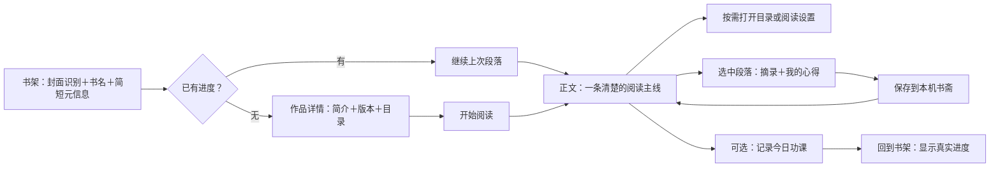

# 阅读产品与经典内容库界面实访

核查日期：2026-11-20。范围仅为公开页面，未登录、不创建账号、不读取私人资料；使用 Chrome 9223 新建专用标签，导航均固定标签 ID。浏览器继承设备主题和可能的扩展，因此截图颜色不作为各站默认主题的证据。页面文字、控件和布局尺寸均为现场读取；下面分别标明观察事实和设计建议。

## 结论先行

梵烬需要把“找书”“了解此版本”“阅读”“记录”划分成清楚的视觉任务。成熟产品的共同点不是少放文字，而是让不同阶段只看到当前需要的文字：目录给识别信息，详情给版本和来源，正文给内容，注释和笔记在需要时打开。不要让书架卡片承担详情页，也不要让阅读页同时展开展示目录、原文、版权说明、提示、笔记表单和偏好设置。

本次完成三家可访问站点：Standard Ebooks、SuttaCentral、中文维基文库。Project Gutenberg 当时只有维护页，未作为设计证据。没有臆测登录后的笔记行为，也没有以未访问的 Readwise 等产品补充结论。

## 一、Standard Ebooks：发现、详情、正文三个层级

### 核查地址

- [书目目录](https://standardebooks.org/ebooks)
- [书籍详情示例](https://standardebooks.org/ebooks/henry-wade/the-duke-of-yorks-steps)
- [独立目录页](https://standardebooks.org/ebooks/henry-wade/the-duke-of-yorks-steps/text)
- [第一章](https://standardebooks.org/ebooks/henry-wade/the-duke-of-yorks-steps/text/chapter-1)
- [官方使用帮助](https://standardebooks.org/help/how-to-use-our-ebooks)

### 实际观察

1. 目录页标题为 `Browse Ebooks`，下面集中放 Subjects、Keywords、Sort、View、Per page。可切 Grid/List，页大小 12/24/48；排序包含发布日期、作者、易读度、长度和受欢迎程度。分类/作者的专门入口与作品列表并存，检索控件没有散落到每本书卡片。
2. 网格条目可观察到独立图像链接、书名链接和作者链接。书目列表主要承担“识别这是什么书”，没有把每本的长简介、版权、来源和帮助说明展开。
3. 详情示例将书名、作者、`80,420 words (4 hours 53 minutes)`、阅读难度、系列序号和题材集中展示。长简介随后出现。`Read Free` 以下再组织电子书格式下载与在线阅读入口；在线阅读分为“Start from the table of contents”和“Read on one page”。
4. “A Brief History of This Ebook”“More Details”“Sources”“Improve This Ebook”是下层内容。Sources 明确区分 transcription 和 page scans；更正入口指向如何报告错误。来源与版本可查，但不会插入每段正文。
5. 章节页顶部只有站标、`Back to ebook`、`Table of contents` 三个导航链接。目录是独立页面，章标题以下立即进入正文，未观察到常驻笔记编辑器。
6. 1460 CSS 像素视口中，正文段宽约 607.6px，字号18px，行高27px（1.5），Georgia/serif。390px 手机模拟中段宽326px、左右各32px、仍为18px/27px，整页宽390px，无页面横向溢出。英文排版参数只能作英文实例，不能直接规定中文行距。
7. 官方帮助主要解决“我该下载哪种文件”和“怎样传到设备”；按设备类型分组。阅读页不反复解释这些操作。没有实测电子书阅读器上的交互，不能据此断言其网页有自动续读或笔记功能。

### 梵烬可借鉴

- 用可辨识的书籍缩略图/封面块、明确书名和一行作者/学派构成书架；封面块需来源安全，可用本站自制文字书封，不能随意借用商业封面。
- 卡片仅保留“书名、作者/时代、全文/节选、阅读动作”；来源和长简介进作品详情。已有进度时主动作改为“继续第X章”，不同时放五个同等强调按钮。
- 作品详情按“阅读入口 → 简介 → 目录 → 版本与许可”的层级组织。原文版、注释版必须显式命名。
- 备份、浏览器存储、导出等帮助放书斋设置或独立说明页，以短提示链接进入。

### 不照搬

- 梵烬是中文原典自修站，不把英文可读性分数或人气榜当核心排序，也不添加虚构热度。
- 首版无需四种设备文件下载；主动作仍是直接阅读。
- 不复制其截图里的暗色主题作为“站点默认”；该状态可能来自设备设定。

## 二、SuttaCentral：工具逐步展开，注释与正文分层

### 核查地址

- [首页](https://suttacentral.net/)
- [SN 45.2 · Bhikkhu Sujato 译文](https://suttacentral.net/sn45.2/en/sujato)
- [本次打开 Views 后实际 URL](https://suttacentral.net/sn45.2/en/sujato?lang=en&layout=plain&reference=none&notes=asterisk&highlight=false&script=latin)

### 实际观察

1. 首页先给产品定位、佛典导航和 Editions 入口，后面才解释 What’s here、Where to begin、Related projects、Reader’s Guides。首页官方说明承认经典很多且不容易开始阅读，提供入门路线；这些说明没有铺到每篇经文前面。
2. 示例经文页的上方依次是多级集合面包屑、经名与译者、正文题名。工具以 `info / views / parallels / Voice` 组织；当前短篇的目录按钮在DOM中存在但隐藏，未假定所有经文都需要同一组工具。
3. 实际点击 Views 后打开工具面板，注释区提供 `None`、`Tooltip on asterisk`、`Show as sidenotes`。这验证了“完全不显示、星号悬浮、旁注”是明确不同的阅读模式，而不是把注释强塞进原文流。
4. 同一面板的原译对照提供 `Plain`、`Side by side`、`Line by line` 及 `Root text first`。另有词典、参考编号、校勘高亮等工具；工具说明中明确词义查询只是辅助，并非总是准确。
5. DOM body 文本读取会把注释文字也收进来，但这不代表它默认在屏幕上完整展示；真实截图确认工具面板当前选的是 `Tooltip on asterisk`。研究中不能仅凭爬取文本长度判断视觉拥挤。
6. 390px手机模拟时，正文宽358px、左右16px，英文正文16px/24px；主要工具图标触控区约48px。已打开的 Views 面板在手机截图中是横向多栏，第二组设置部分在屏幕外，页面总宽仍390px。这说明设置面板的内部布局也必须单独验收，不能仅检查页面有没有横向滚动。
7. 未观察到私人笔记入口；不能把学术注释功能说成用户笔记功能。来源信息按钮、平行经文和朗读工具已看到，但未启动音频，也未核验整个平行经文操作链。

### 梵烬可借鉴

- 常驻只保留返回书架、当前位置、目录、阅读设置、笔记五个轻量入口；正文是默认唯一展开的主要区域。
- “古注”和“我的心得”是两类内容：古注需要出处，可折叠；私人心得按段打开侧栏/底部面板，不能混合成同一种灰字注释。
- 阅读设置按三组显示：外观（纸色/字号）、文字（繁简）、对照（古注/导读）。没有可显示的内容时禁用或隐藏对照项，并给出简短状态。
- 长篇目录要按卷/章分组，短篇可无需整列目录；工具数量由内容决定。

### 不照搬

- 不把多语词典、音译脚本、大量校勘版本全部搬入梵烬首版。
- 不照搬手机横向多栏设置面板；梵烬应使用一列分组设置、足够触控区和清楚关闭动作。
- 本机私人心得不需要论坛、账号或远程同步；SuttaCentral 的关联社区不是梵烬范围。

## 三、中文维基文库：先解决“是哪一版本”

### 核查地址

- [中文首页](https://zh.wikisource.org/wiki/首页)
- [道德经版本目录](https://zh.wikisource.org/wiki/道德經)
- [道德真经正文](https://zh.wikisource.org/wiki/道德真經)

### 实际观察

1. 《道德經》页面不是任意一个版本的全文，而是“道德經的版本”索引。原文与注释分别成区，注释再按汉、魏晋、唐、宋等时期分组。王弼注本和其他版本有独立链接。
2. 《道德真經》正文头部说明作品收录于《正統道藏》，标注“洞神部本文類・慕一・二卷”“影印：明正統十年內府刊本”，并链接回更多版本资料。底本信息在正文前可查，但不是每个段落重复一遍。
3. 桌面有左目录、中正文、右外观工具。目录和外观都有“隐藏”控制；外观包含字号小/标准/大、宽度标准/宽、颜色自动/浅色/深色。标题附近另有阅读、编辑、历史、工具等协作入口。
4. 在1460 CSS像素视口下，本次正文段宽约916.7px、16px/26px。是相当宽的资料页面；这不构成适合中文长读的证据。其强项是版本组织和出处透明，不能因为成熟就复制所有几何参数。
5. 所读版本保留了无标点古文；页面还明确标注某处“由此處起體例改變，但原書如此”。这是一种忠实于底本而不假装统一版式的做法。
6. 本次仅对同一桌面URL做390px设备模拟，布局视口仍为1120px，截图呈缩小桌面布局。没有访问其独立“移动版视图”，因此不能断言维基文库的正式移动版本不响应式，也不能声称完成其移动皮肤体验验收。

### 梵烬可借鉴

- 保留版本名、译者/编者、原文来源、全文/节选状态，使用户知道自己读什么。
- 后续同书多个版本可以在作品详情提供版本选择；首版一书一底本时不用空造复杂选择器。
- 把原文、古注、现代导读分别命名，来源不详就诚实写明，不拼出一个虚假的“完整权威版本”。

### 不照搬

- 社区协作入口、编辑历史、跨站资料、广告式庆祝横幅不进入梵烬阅读核心区。
- 桌面三栏都展开会占据阅读注意力；梵烬默认收起目录或笔记，展开一个辅助面板时保持正文宽度。
- 不复制其首页长串索引链接作为书架。数据多不等于必须让用户同时阅读所有分类说明。

## 四、未采用的候选与证据边界

[Project Gutenberg ebooks](https://www.gutenberg.org/ebooks/) 实际返回 `Temporarily Down for Maintenance`，并说明网站正在维护。未观察到书目页、阅读页或手机界面，所以没有给它编造可借鉴的产品事实。

截图中右下角粉色浮动按钮可能来自浏览器扩展，不应当成产品功能。Standard Ebooks一次桌面截图超时，未把失败截图写入证据列表；后续手机截图成功。SuttaCentral设置面板打开后截图是“工具展开态”，不能冒称默认阅读态。

## 五、梵烬核心流程与视觉规划建议

### 画面分工

| 场景 | 主视觉/主任务 | 默认可见 | 按需展开 |
|---|---|---|---|
| 书架 | 识别一本书并开始读 | 简洁封面、书名、学派/作者、全文/节选、一个主动作 | 简介、版本、许可、完整统计 |
| 有进度的首页 | 一眼找到上次阅读 | 一张续读卡及当前章节，下面已有书架 | 全部历史、笔记和偏好设置 |
| 作品详情 | 知道版本并选择章节 | 书名、短简介、开始阅读、目录、来源摘要 | 完整许可、校勘说明、原始文件 |
| 阅读桌面 | 正文持续阅读 | 当前章节、舒适版心、少量工具、上下章 | 目录侧栏、心得侧栏、外观设置 |
| 阅读手机 | 单列正文 | 返回、章节位置、目录/设置/笔记入口 | 互斥的底部面板；一次只开一个 |
| 摘录 | 回看原句和自己的体会 | 书名/段落出处、引用块、心得正文 | 编辑、删除、导出 |
| 数据设置 | 备份和本机数据说明 | 简洁数据概览、导出、导入 | 替换预览、危险操作二次确认 |

### 建议的第一轮设计约束（属于梵烬方案，不是他站测量结果）

- 书架卡片最多两行简介，强制书名和主动作优先；不再把数据库字段逐项排成说明书。
- 视觉以“书”作为识别单位：统一比例、自制文字书封、小幅学派色差。既不用空白矩形充数，也不用随机装饰图抢走标题。
- 阅读桌面正文目标宽约680px；中文字号18px、行高约1.9作为起点。手机左右20–24px，控件至少44px触控区。具体仍以真实中文长段和设备验收。
- 正文中的操作入口仅在当前段落聚焦/选中时强调，未选中的每段不重复堆按钮和提示。
- 点击笔记才开编辑器，保存后显示简短确认，不在正文旁长驻“如何记心得”的说明。
- 个人数据保存在本机的提示保留一次清楚的站点说明和设置页详情，不要每个面板重复整段警告。
- 空状态给“下一步可做什么”及一个按钮；不能用长篇产品介绍填满空书架。

## 六、留存证据

位于 `output/research/reading-products/`：

- `standard-chapter.txt`：章节正文与导航文本。
- `wikisource-daode.txt`：道德真经底本说明与正文文本。
- `mobile-observations.json`：三站视口、正文尺寸、控件布局现场测量。
- `standard-mobile.png`：Standard Ebooks章节390px视口。
- `sutta-reader-desktop.png`：SuttaCentral桌面页面。
- `sutta-mobile.png`：SuttaCentral打开Views面板后的390px视口。
- `wikisource-versions-desktop.png`：道德经版本索引的桌面界面。
- `wikisource-mobile.png`：桌面URL在390px设备模拟下的状态，不能替代正式移动皮肤。

本轮只研究和落文档，没有修改 src、账号机制、内容授权声明或生产发布。
