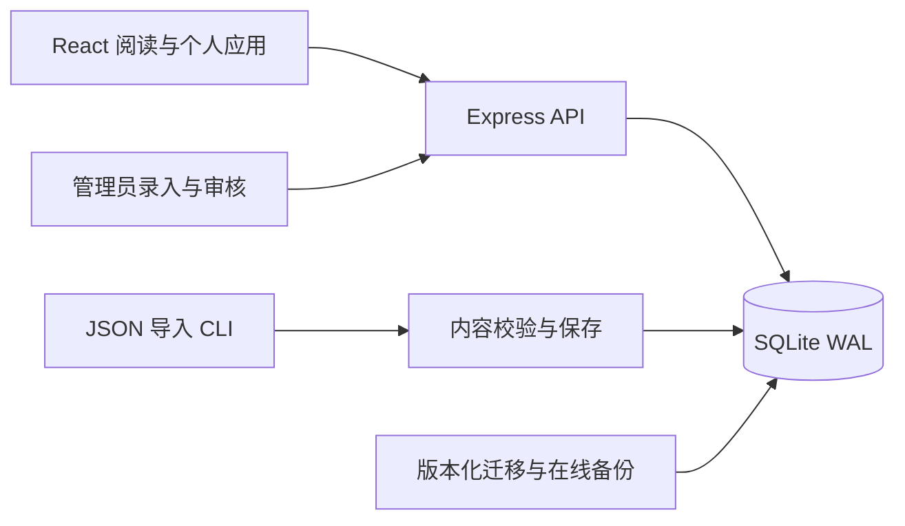

 > 历史服务器版本参考。当前公开版本使用 GitHub Pages 与本机 IndexedDB，参见 [现行文档](../README.md)。

# 系统架构

梵烬是以经典阅读和个人自修为核心的公益应用。公共内容与用户私人记录分开管理；活动、讨论和多人共修已退出当前产品范围。

## 运行结构

开发时 Vite 代理 `/api` 到后端；生产时 Express 提供 `dist` 和 API，前端深链接返回应用首页。前端按页面懒加载。数据库使用 WAL、外键约束和写入等待，适合当前单实例部署。

## 后端责任

| 模块 | 责任 |
| --- | --- |
| `index.ts` | 初始化、公共接口、后台入口、静态资源及错误处理 |
| `db.ts`、`migrations.ts` | 连接、基础结构、生产初始化、迁移账本、迁移前在线备份 |
| `auth.ts`、`security.ts` | 密码和恢复码、会话期限、Cookie、来源检查、限流、角色检查 |
| `content.ts`、`validation.ts` | 经典与段落校验、来源元数据、审核、下架、简繁检索 |
| `personal.ts` | 私人进度、摘录快照与导出、勘误反馈 |
| `bookshelf.ts` | 本人书架聚合与段落书签 |
| `preferences.ts` | 本人的兴趣、每日时间与阅读方式 |
| `study.ts` | 私人计划、每日记录、段落完成记录与统计 |
| `product-migration.ts` | 精确替换旧默认文案，保留用户自定义内容 |
| `import-scripture.ts` | JSON 预检和调用同一保存路径导入 |

## 内容与阅读

一部经典含稳定标识、版本、来源、许可、学派/标签和按顺序排列的段落。段落分别存原文、可核对古注与现代导读；繁体底本和校对简体可分别存在，空缺层不伪造内容。FTS5 trigram 索引配合 OpenCC 规范化支持简繁查询，短关键词采用限定字段匹配；检索仅返回已发布内容。

管理员创建或修改经典后进入待审核。发布要求来源元数据完整且核验确认；旧审核记录不能批准后来的版本。下架立即影响公开详情、搜索和新增个人行为。段落被书签、摘录、进度、功课等引用时不能删除，已有摘录保存时的原文快照不会随经典修改而重写。

## 私人数据

用户身份由会话确定，客户端传入的 `userId` 不决定归属。书架聚合本人收藏、进度、计划、摘录与书签；没有虚构阅读人数或社交动态。阅读偏好、笔记和功课均由本人维护；管理员审核公共内容不等于公开用户私人心得。

每日功课以北京时间的自然日为界，每个计划每天只有一条时长记录。重复提交不累加时长；逐段完成记录独立保存。同日阅读多段不会产生多天或重复时长。

## 会话与生产

密码用独立随机盐和 scrypt；会话 token 的哈希保存在数据库，有效期七天。浏览器优先使用 HttpOnly、SameSite=Lax Cookie，生产强制 Secure；密码修改、恢复和停用账号会撤销旧会话。所有 `/api/admin/*` 仅允许管理员。

正式部署不创建开发样例账户/经典。首次管理员来自环境变量，已经初始化的账户不会被重复重置。迁移前备份包含 WAL 中已提交数据，全部待执行迁移在同一事务内完成；备份和私人数据库均需限制访问并做异地保留。

音频当前以经过校验的 HTTPS URL 关联，没有独立上传或对象存储服务。外部资源可用性和内容授权需要独立核对。历史社区表仍可保留，但旧接口返回 410，不能作为活动或社区能力继续运营。
